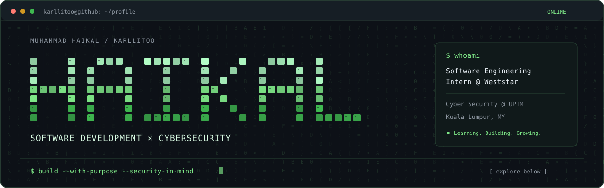
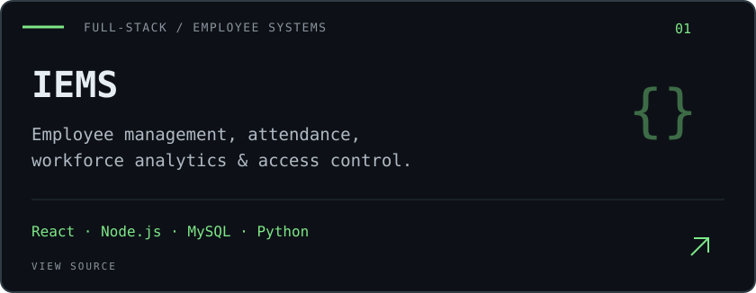
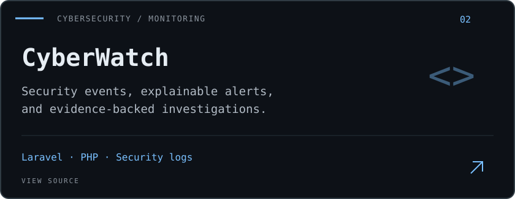
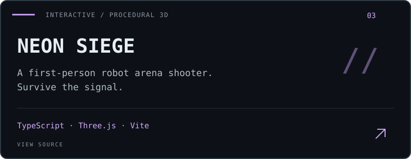
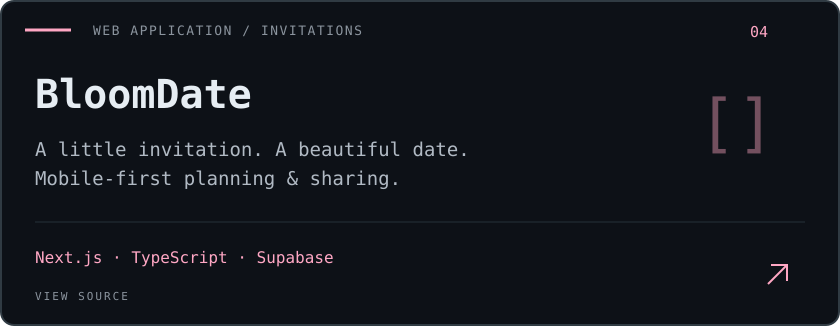
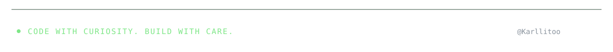

<div align="center">
  

  # Hi, I'm Muhammad Haikal 👋

  **Software Engineering Intern at Weststar · Cyber Security student at UPTM**

  Building useful software. Learning to make it safer.

  [](https://www.linkedin.com/in/muhammad-haikal-b5b06831b/)
  [](https://karllitoo.github.io/portfolio/)
  [](https://github.com/Karllitoo?tab=repositories)
</div>

---


### `01 / whoami`

I'm a **software development and cybersecurity student** based in **Kuala Lumpur, Malaysia**. I enjoy combining practical development with security-focused thinking—from an interface people can use to the access controls behind it.

- 💼 **Now:** Software Engineering Intern at **Weststar Engineering Sdn Bhd**.
- 🎓 **Studying:** Bachelor of Information Technology (Honours), majoring in **Cyber Security** at **Universiti Poly-Tech Malaysia**.
- 🛠️ **Building:** Full-stack applications, security monitoring tools, and interactive web experiences.
- 🔎 **Exploring:** Application security, threat intelligence, and data analytics.
- 🤝 **Let's talk:** Software projects, cybersecurity, or opportunities to learn and build together.

<br clear="right" />

### `02 / languages & tools`

<p align="center">
  
  
  
  
</p>
<p align="center">
  
  
  
  
  
</p>
<p align="center">
  
  
  
  
  
</p>

### `03 / selected builds`

<p align="center">
  <a href="https://karllitoo.github.io/portfolio/"></a>
</p>

**[Haikal · Personal Portfolio](https://karllitoo.github.io/portfolio/)**

My background, selected work, and experience inside an interactive Three.js temple world. Built with React, TypeScript, and Vite, with responsive layouts, project dialogs, and my own portrait.

**[Visit the live portfolio](https://karllitoo.github.io/portfolio/)** · [Explore the source](https://github.com/Karllitoo/portfolio)


<p align="center">
  <a href="https://github.com/Karllitoo/intelligent-employee-management-system"></a>
  <a href="https://github.com/Karllitoo/CyberWatch"></a>
  <a href="https://github.com/Karllitoo/neon-siege"></a>
  <a href="https://github.com/Karllitoo/bloomdate"></a>
</p>

| Project | What I built | Explore |
| :--- | :--- | :--- |
| **[Haikal Portfolio](https://github.com/Karllitoo/portfolio)** | An English personal portfolio with a live Three.js temple scene, project details, portrait, and professional background. | [Live website](https://karllitoo.github.io/portfolio/) · [Source](https://github.com/Karllitoo/portfolio) |
| **[Intelligent Employee Management System](https://github.com/Karllitoo/intelligent-employee-management-system)** | Employee records, attendance, leave, reporting, and workforce analytics with authentication and role-based access. | [Source ↗](https://github.com/Karllitoo/intelligent-employee-management-system) |
| **[CyberWatch](https://github.com/Karllitoo/CyberWatch)** | A Laravel portfolio project for security logs, rule-based detection, evidence-backed alerts, and investigations. | [Source ↗](https://github.com/Karllitoo/CyberWatch) |
| **[NEON SIEGE](https://github.com/Karllitoo/neon-siege)** | A single-player robot arena shooter with procedural visuals and sound, built with TypeScript, Three.js, and Vite. | [Source ↗](https://github.com/Karllitoo/neon-siege) |
| **[BloomDate](https://github.com/Karllitoo/bloomdate)** | A mobile-first invitation and date-planning application using Next.js, TypeScript, Tailwind CSS, and Supabase. | [Live demo ↗](https://bloomdate-gilt.vercel.app) · [Source ↗](https://github.com/Karllitoo/bloomdate) |

### `04 / the way I build`

```text
understand the problem
    └── build a practical solution
          └── protect the data and access
                └── test, learn, and improve
```

My IEMS project gave me experience with **JWT authentication, email OTP verification, role-based access control, password hashing, rate limiting, and audit logging**. CyberWatch lets me explore security monitoring through **explainable detection rules and evidence-backed investigations**.

I'm still learning—and I like turning that learning into something you can actually use.

### `05 / connect`

Interested in my work, building something useful, or exchanging ideas about development and security?

**[Let's connect on LinkedIn ↗](https://www.linkedin.com/in/muhammad-haikal-b5b06831b/)**

<div align="center">
  
</div>
